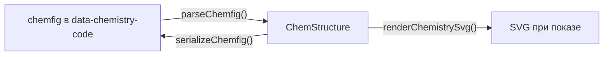

# 16. Структурные формулы: `@rich-editor/chemistry`

## Назначение

Структурная формула — атомарный инлайновый узел `chemistry`. Источник истины —
код chemfig в атрибуте `data-chemistry-code`; картинка рисуется по коду при
показе и в HTML не хранится. Пакет даёт редактору узел, кнопку тулбара и
диалог-конструктор с готовыми формулами, а вьюеру — лёгкий вход без TipTap. Разметка
совместима с PinQueen: читаются `span` и `div` с `data-chemistry-code`.



## Когда использовать

- Органика: цепочки, ветви, кольца с заместителями. Уравнения реакций и
  нотация `\ce{}` — это формулы типа `chem` ([04](04-formulas.md)), не этот пакет.
- Документы от распознавания: узлы приходят с кодом, который наш рендер может
  не понять, — код сохраняется как есть и показывается текстом.

## Интерфейс

Сигнатуры — [14-api-reference.md](14-api-reference.md#rich-editorchemistry).

### Подключение

| Где | Что | Вход |
| --- | --- | --- |
| Редактор | `createRichEditor({ features: [createChemistryFeature()] })`, `<RichEditor :features>` | `@rich-editor/chemistry` |
| Вьюер | `createRichContent({ features: [chemistryContent] })`, `<RichContent :features>` | `@rich-editor/chemistry/viewer` |
| Стили | Подключаются сами при импорте из исходников; для `dist` — `@rich-editor/chemistry/styles.css` | — |

`createChemistryFeature({ toolbarItem?: boolean, code?: boolean })` —
`toolbarItem: false` убирает кнопку, узел при этом читается из разметки;
`code: true` добавляет в окно поле с кодом chemfig (по умолчанию выключено).
Подписи возможность несёт сама (`CHEMISTRY_MESSAGES`, ru и en); `messages`
хоста их переопределяют.

### Окно «Структурная формула»

Окно — конструктор. На полотне рисуется формула; у выделенного атома вокруг
стоят кнопки «плюс» по направлениям, нажатие присоединяет выбранную группу.
Справа:

- палитра групп (CH₃, CH₂, CH, C, H, OH, O, NH₂, N, COOH, CHO, Cl, Br, F, I, S,
  NO₂) и поле «Своя группа»;
- тип связи: одинарная, двойная, тройная;
- свойства выделенного: заменить группу, удалить;
- кольца: бензол, шестиугольник, пятиугольник;
- «Готовые формулы», отмена, повтор и «Очистить».

Конструктор правит разобранную модель (`ChemStructure`) и записывает её в код
новой функцией `serializeChemfig`; рисует тем же `renderChemistrySvg`, раскладка
вынесена в `layoutChemistry`. Формат узла не менялся: в нём по-прежнему код
chemfig из подмножества ниже.

- **Код в окне.** Только с `code: true` под конструктором есть поле с кодом
  chemfig. Пока в поле код, который не разбирается, сохранить нельзя и
  конструктор заперт; правка поля, которая разбирается, — один шаг истории.
- **Сохранение без правок** не переписывает код узла: если структуру не меняли,
  записывается исходный код байт в байт. После правки записывается
  нормализованная запись (явные углы и т. п.).
- **Код, который не разбирается, при `code: false`**: полотно пустое, показано
  сообщение (`chemistry_unreadable`); сохранить можно, только собрав формулу
  заново.
- **Клавиатура.** Атомы, связи и «плюсы» — фокусируемые кнопки с подписями
  для скринридера («Атом CH₃», «Связь CH₃ – CH₂: одинарная»), обход идёт в этом
  порядке; `Enter` и пробел нажимают. `Delete` и `Backspace` удаляют
  выделенное; у вершины кольца с подписью убирают подпись, у вершины без
  подписи ничего не происходит. `Escape` снимает выделение и не закрывает окно,
  пока выделение есть.

### Формат узла

```html
<span data-chemistry="true" data-chemistry-code="CH_3-CH_2-OH" data-chemistry-type="chemfig"
      class="rte-chemistry" role="img" aria-label="Структурная формула: CH_3-CH_2-OH"></span>
```

| Атрибут | Что хранит |
| --- | --- |
| `data-chemistry-code` | Код chemfig без обёртки `\chemfig{}`; обязателен, узел без него не читается |
| `data-chemistry-type` | `chemfig`; другой записи пока нет |
| `aria-label` | Имя для читалки: подпись и код |

Правила санитайзера — `CHEMISTRY_SANITIZER_RULES` (три атрибута выше);
серверная копия — `CHEMISTRY_ATTRS` в `rich_editor/sanitize.py`, тест
контракта сверяет.

### Поддерживаемое подмножество chemfig

| Конструкция | Пример | Что рисуется |
| --- | --- | --- |
| Цепочка | `CH_3-CH_2-OH` | Подписи на подложке, связи между ними |
| Угол связи | `A-[:45]B`, `A-[1]B` | `[:n]` — градусы, `[n]` — доли по 45°; остальные параметры пропускаются |
| Начальный угол | `[:30]A-B` | Направление первой связи без угла |
| Связи | `-`, `=`, `~` | Одна, две, три линии |
| Ветви | `C(-[2]H)(-[6]H)-H` | Без угла — поперёк цепи: вверх, вниз, затем наискось |
| Кольцо | `*6(------)`, `*5(-=-=-)` | Правильный многоугольник; типы связей по сторонам |
| Ароматика | `**6(------)` | Окружность внутри |
| Вершина кольца | `*6(-=-N=-=)` | Подпись заменяет углерод в той вершине, до которой дошли связи |
| Заместитель кольца | `**6(---(-OH)---)`, `CH_3-*6(------)` | Уходит наружу; явный угол внутрь разворачивается |
| Индексы | `CH_3`, `SO_4^{2-}`, `CH3` | Юникод-индексы и степени |

Вне подмножества: продолжение цепи после кольца, кольцо внутри цепи,
клиновидные связи `>`/`<`, относительные углы `[::30]`, параметры длины.
Такой код не роняет редактор: узел сохраняет его и показывает текстом с
классом `rte-chemistry--invalid`. В окне с `code: true` такой код сохранить
нельзя, пока он в поле; без `code` конструктор его не открывает (см. выше).

### Чистые функции

| Функция | Возвращает | Что делает |
| --- | --- | --- |
| `parseChemfig(code)` | `ChemStructure` | Разбор; бросает `ChemfigSyntaxError` с позицией |
| `tryParseChemfig(code)` | `ChemStructure` или `null` | То же без исключения |
| `renderChemistrySvg(structure, { scale? })` | `string` | SVG; цвета — `currentColor`, подложка подписи — класс под тему |
| `chemfigToSvg(code, { scale? })` | `string` или `null` | Разбор и рендер; `null`, если код не разобрать |
| `serializeChemfig(structure)` | `string` | Модель → код chemfig; `parseChemfig(serializeChemfig(s))` даёт равную модель, пустая модель — пустую строку |
| `layoutChemistry(structure, { scale? })` | `ChemLayout` | Раскладка в координатах `renderChemistrySvg`: размеры, атомы и связи с координатами |
| `formatChemLabel(label)` | `string` | `CH_3` → `CH₃` |
| `unwrapChemfig(code)` | `string` | Снимает `\chemfig{…}` |
| `paintChemistryNode(element, code, { scale, accessibleName? })` | `void` | Рисует SVG внутри элемента узла через `sanitizeSvg` |

Команды TipTap для авторов возможностей: `insertChemistry({ code, type? })`,
`updateChemistry({ pos, code })`, `deleteChemistryAt(pos)`.

## Пример

```ts
import { createRichEditor } from '@rich-editor/core';
import { createChemistryFeature } from '@rich-editor/chemistry';

const editor = createRichEditor({
  element: document.querySelector('#editor')!,
  features: [createChemistryFeature()],
});

// Кнопка «Структурная формула» встаёт своей группой в конец тулбара; чтобы
// поставить её рядом с формулами, перечислите id `chemistry` в конфигурации.
```

```ts
import { createRichContent } from '@rich-editor/core/viewer';
import { chemistryContent } from '@rich-editor/chemistry/viewer';

createRichContent({ element, html, features: [chemistryContent] });
```

## Ограничения

- SVG в документе не хранится: вьюер без документной части вырежет узлы
  санитайзером. Standalone-сборка и Django-виджет пакет пока не включают.
- Раскладка не ищет наложений: длинные ветви с одинаковыми углами могут
  пересечься — так же, как в исходном PinQueen.
- Конструктор собирает одну цепочку с ветвями или одно кольцо с
  заместителями. Второе кольцо, кольцо в середине цепочки и конденсированные
  кольца собрать нельзя; у сторон кольца только одинарная или двойная связь.
  Клинья и «крюки» chemfig не поддерживаются, как и в разборе. Такой код
  можно ввести только при `code: true` (если он разбирается).
- Перетаскивания атомов нет.

## См. также

- [03-vanilla-ui.md](03-vanilla-ui.md#возможность-editorfeature),
  [06-viewer.md](06-viewer.md#возможности-во-вьюере-contentfeature),
  [11-security.md](11-security.md#правила-возможностей).
