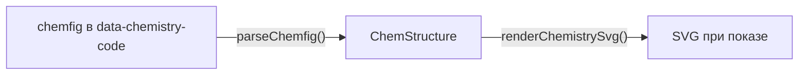

# 16. Структурные формулы: `@rich-editor/chemistry`

## Назначение

Структурная формула — атомарный инлайновый узел `chemistry`. Источник истины —
код chemfig в атрибуте `data-chemistry-code`; картинка рисуется по коду при
показе и в HTML не хранится. Пакет даёт редактору узел, кнопку тулбара и
диалог с шаблонами и живым превью, а вьюеру — лёгкий вход без TipTap. Разметка
совместима с PinQueen: читаются `span` и `div` с `data-chemistry-code`.



## Когда использовать

- Органика: цепочки, ветви, кольца с заместителями. Уравнения реакций и
  нотация `\ce{}` — это формулы типа `chem` ([04](04-formulas.md)), не этот пакет.
- Документы от распознавания: узлы приходят с кодом, который наш рендер может
  не понять, — код сохраняется как есть и показывается текстом.

## Интерфейс

Сигнатуры — [14-api-reference.md](14-api-reference.md#rich-editorchemistry).

### Подключение

| Где | Что | Вход |
| --- | --- | --- |
| Редактор | `createRichEditor({ features: [createChemistryFeature()] })`, `<RichEditor :features>` | `@rich-editor/chemistry` |
| Вьюер | `createRichContent({ features: [chemistryContent] })`, `<RichContent :features>` | `@rich-editor/chemistry/viewer` |
| Стили | Подключаются сами при импорте из исходников; для `dist` — `@rich-editor/chemistry/styles.css` | — |

`createChemistryFeature({ toolbarItem?: boolean })` — `toolbarItem: false`
убирает кнопку, узел при этом читается из разметки. Подписи возможность несёт
сама (`CHEMISTRY_MESSAGES`, ru и en); `messages` хоста их переопределяют.

### Формат узла

```html
<span data-chemistry="true" data-chemistry-code="CH_3-CH_2-OH" data-chemistry-type="chemfig"
      class="rte-chemistry" role="img" aria-label="Структурная формула: CH_3-CH_2-OH"></span>
```

| Атрибут | Что хранит |
| --- | --- |
| `data-chemistry-code` | Код chemfig без обёртки `\chemfig{}`; обязателен, узел без него не читается |
| `data-chemistry-type` | `chemfig`; другой записи пока нет |
| `aria-label` | Имя для читалки: подпись и код |

Правила санитайзера — `CHEMISTRY_SANITIZER_RULES` (три атрибута выше);
серверная копия — `CHEMISTRY_ATTRS` в `rich_editor/sanitize.py`, тест
контракта сверяет.

### Поддерживаемое подмножество chemfig

| Конструкция | Пример | Что рисуется |
| --- | --- | --- |
| Цепочка | `CH_3-CH_2-OH` | Подписи на подложке, связи между ними |
| Угол связи | `A-[:45]B`, `A-[1]B` | `[:n]` — градусы, `[n]` — доли по 45°; остальные параметры пропускаются |
| Начальный угол | `[:30]A-B` | Направление первой связи без угла |
| Связи | `-`, `=`, `~` | Одна, две, три линии |
| Ветви | `C(-[2]H)(-[6]H)-H` | Без угла — поперёк цепи: вверх, вниз, затем наискось |
| Кольцо | `*6(------)`, `*5(-=-=-)` | Правильный многоугольник; типы связей по сторонам |
| Ароматика | `**6(------)` | Окружность внутри |
| Вершина кольца | `*6(-=-N=-=)` | Подпись заменяет углерод в той вершине, до которой дошли связи |
| Заместитель кольца | `**6(---(-OH)---)`, `CH_3-*6(------)` | Уходит наружу; явный угол внутрь разворачивается |
| Индексы | `CH_3`, `SO_4^{2-}`, `CH3` | Юникод-индексы и степени |

Вне подмножества: продолжение цепи после кольца, кольцо внутри цепи,
клиновидные связи `>`/`<`, относительные углы `[::30]`, параметры длины.
Такой код не роняет редактор: узел сохраняет его и показывает текстом с
классом `rte-chemistry--invalid`, диалог предупреждает, но вставить разрешает.

### Чистые функции

| Функция | Возвращает | Что делает |
| --- | --- | --- |
| `parseChemfig(code)` | `ChemStructure` | Разбор; бросает `ChemfigSyntaxError` с позицией |
| `tryParseChemfig(code)` | `ChemStructure` или `null` | То же без исключения |
| `renderChemistrySvg(structure, { scale? })` | `string` | SVG; цвета — `currentColor`, подложка подписи — класс под тему |
| `chemfigToSvg(code, { scale? })` | `string` или `null` | Разбор и рендер; `null`, если код не разобрать |
| `formatChemLabel(label)` | `string` | `CH_3` → `CH₃` |
| `unwrapChemfig(code)` | `string` | Снимает `\chemfig{…}` |
| `paintChemistryNode(element, code, { scale, accessibleName? })` | `void` | Рисует SVG внутри элемента узла через `sanitizeSvg` |

Команды TipTap для авторов возможностей: `insertChemistry({ code, type? })`,
`updateChemistry({ pos, code })`, `deleteChemistryAt(pos)`.

## Пример

```ts
import { createRichEditor } from '@rich-editor/core';
import { createChemistryFeature } from '@rich-editor/chemistry';

const editor = createRichEditor({
  element: document.querySelector('#editor')!,
  features: [createChemistryFeature()],
});

// Кнопка «Структурная формула» встаёт своей группой в конец тулбара; чтобы
// поставить её рядом с формулами, перечислите id `chemistry` в конфигурации.
```

```ts
import { createRichContent } from '@rich-editor/core/viewer';
import { chemistryContent } from '@rich-editor/chemistry/viewer';

createRichContent({ element, html, features: [chemistryContent] });
```

## Ограничения

- SVG в документе не хранится: вьюер без документной части вырежет узлы
  санитайзером. Standalone-сборка и Django-виджет пакет пока не включают.
- Раскладка не ищет наложений: длинные ветви с одинаковыми углами могут
  пересечься — так же, как в исходном PinQueen.
- Конструктора с перетаскиванием нет: структура правится кодом с превью.

## См. также

- [03-vanilla-ui.md](03-vanilla-ui.md#возможность-editorfeature),
  [06-viewer.md](06-viewer.md#возможности-во-вьюере-contentfeature),
  [11-security.md](11-security.md#правила-возможностей).
