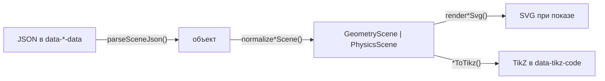

# 17. Чертежи: `@rich-editor/drawings`

## Назначение

Чертёж — блочный атомарный узел `geometry` или `physics`. Источник истины —
JSON-сцена в формате PinQueen в атрибуте `data-geometry-data` /
`data-physics-data` и TikZ в `data-tikz-code`; картинка рисуется по сцене при
показе и в HTML не хранится. Пакет даёт редактору два узла, две кнопки
тулбара и диалог с конструкторами (а с опцией `json` — ещё с JSON, образцами, превью и TikZ), а вьюеру — лёгкий вход без
TipTap. Сцена хранится строкой как пришла: поля, которых рендер не знает, не
теряются.



## Когда использовать

- Геометрия: планиметрия (вершины, рёбра, углы, засечки, окружности),
  стереометрия (3D-вершины, сечения, цилиндры, конусы, шары, кабинетная проекция), графики
  функций (парабола, корень, гипербола, прямая, окружность, штриховка, точки).
- Физика: механика, термодинамика, электрические цепи, оптика — элементы с
  типом и координатами.
- Документы от распознавания: сцены приходят «грязными», нормализация
  принимает синонимы и старые форматы; битый JSON показывается плейсхолдером.

## Интерфейс

Сигнатуры — [14-api-reference.md](14-api-reference.md#rich-editordrawings).

### Подключение

| Где | Что | Вход |
| --- | --- | --- |
| Редактор | `createRichEditor({ features: [createDrawingsFeature()] })`, `<RichEditor :features>` | `@rich-editor/drawings` |
| Вьюер | `createRichContent({ features: [drawingsContent] })` или `createDrawingsContent({ locale })` | `@rich-editor/drawings/viewer` |
| Стили | Подключаются сами при импорте из исходников; для `dist` — `@rich-editor/drawings/styles.css` | — |

`createDrawingsFeature({ toolbarItems?: boolean, json?: boolean })`; подписи — `DRAWINGS_MESSAGES`
(ru, en), `messages` хоста их переопределяют. Заголовки карточек во вьюере
берутся из таблиц возможности по `locale` документной части.

### Формат узла

```html
<div data-geometry="true" data-geometry-data='{"type":"2d","vertices":{…},"edges":[…]}'
     data-tikz-code="\begin{tikzpicture}…" class="rte-drawing rte-drawing--geometry"
     role="img" aria-label="Чертёж"></div>
```

| Атрибут | Что хранит |
| --- | --- |
| `data-geometry-data`, `data-physics-data` | JSON-сцена строкой; узел читается и из `span`, и из `div` PinQueen |
| `data-tikz-code` | TikZ; генерируется диалогом из сцены, при импорте сохраняется |
| `aria-label` | Имя для читалки: «Чертёж» / «Физическая схема» |

Правила санитайзера — `DRAWINGS_SANITIZER_RULES` (пять атрибутов выше);
серверная копия — `DRAWINGS_ATTRS` в `rich_editor/sanitize.py`.

### Чертёж в документе

- Клик по чертежу без перетаскивания открывает его редактор. Раньше редактор
  открывался уже по нажатию, и перетащить чертёж было нельзя; теперь нажатие
  отдаётся редактору документа, а тап на тач-экране приходит тем же `click`.
- Чертёж перетаскивается мышью между блоками документа, `Alt+↑` / `Alt+↓`
  переставляют выделенный чертёж на один блок ([02](02-core.md#перенос-блоков)).
  В режиме «только чтение» чертёж не перетаскивается.
- `Enter` на выделенном чертеже открывает его редактор.

### Модель сцены

Геометрия (`GeometryScene`): `type` `2d | 3d | plot_2d` (правило типа — ниже;
без вершин, но с графиками — `plot_2d`),
`vertices` `{ A: [x, y] | [x, y, z] }`, `edges` (`from`, `to`, `style`
`solid | dashed`, `ticks` 0–4), `angles` (`points` — три вершины, вершина
угла вторая; `style` `right | single | double | triple`; `label`), `labels`
(положение буквы: `below left`, `above`…), `textLabels` (у середины отрезка
`position` со стороной `offset` или в точке `coords` мира), `sections`,
`cylinders`, `cones` и `spheres` (только 3D), `plots`, `angleY`/`angleZ`, `scale`, `offsetX`/`offsetY`,
`showGrid`, `showAxes`, `axes`.

Тела вращения (только 3D):

| Поле | Запись | Что рисуется |
| --- | --- | --- |
| `cylinders` | `{ base, top, radius }` | Цилиндр: центры оснований — вершины `base` и `top` |
| `cones` | `{ base, apex, radius }` | Прямой круговой конус: основание с центром `base` перпендикулярно оси `base → apex` |
| `spheres` | `{ center, radius }` | Шар с центром в вершине `center` |

`radius` по умолчанию 1. Запись с неизвестной вершиной не рисуется.

Тип сцены определяет `normalizeGeometryScene`: `2d` и `plot_2d` из `type`
остаются как есть; иначе сцена 3D, если у какой-то вершины ненулевая `z` либо
есть тело вращения (цилиндр, конус, шар), все вершины которого существуют, и
при этом нет `plots`. Раньше лежащий цилиндр и шар с центром в начале координат
(все `z = 0`) рисовались как 2D. Старые сцены читаются и рисуются как раньше.

Графики (`Plot`): `circle` (`center` или `centerVertex`, `radius`, `fill`),
`parabola` (`vertex`, `direction`, `stretchX`, `stretchY`, `domain`), `sqrt`,
`hyperbola` (`center`, `k`), `line` (`p1`/`p2` или `k`/`b`), `point` (`coords`,
`pointStyle` `solid | hollow`, `label`), `shading` (`points` или `bounds`),
`freehand`.

Физика (`PhysicsScene`): `elements[]` с `id`, `type`, `label` (LaTeX-подмножество:
греческие буквы, индексы, `\vec{}`, `\text{}`), `color`, `dashed` и геометрией
`points` / `center` / `coords`. Типы по разделам:

| Раздел | Типы |
| --- | --- |
| Механика | `surface` (`hatching`), `arc_surface`, `block` (`subtype` rectangle/circle/pulley, `angle`), `rope`, `spring`, `vector` (`vectorType` force/acc), `angle`, `stickman`, `balloon`, `ellipse_platform`, `dimension_line` |
| Термодинамика | `thermo_axes` (`xTicks`/`yTicks`), `thermo_point`, `thermo_process` (`subtype` line/isotherm/isochor), `piston_vessel` |
| Электричество | `circuit_component` (resistor/capacitor/inductor/switch/source/battery/voltmeter/ammeter/lamp/diode), `wire` (`wavy`), `charge`, `field_line`, `capacitor_plate`, `current_conductor`, `circle_shape` |
| Оптика | `lens` (converging/diverging, `focalLength`), `mirror`, `ray`, `optics_arrow`, `prism`, `glass_slab` |
| Общее | `text_label` |

### Нормализация

`parseSceneJson(text)` — терпимый разбор: ограждение ```` ```json ````, LaTeX-слеши
в строках, хвостовые запятые, одинарные и «умные» кавычки, ключи без кавычек,
комментарии; без `eval`. `normalizeGeometryScene(raw)` и
`normalizePhysicsScene(raw)` принимают что угодно и всегда возвращают сцену:
рёбра массивом, `{from,to}`, `{start,end}`, `{source,target}`; `circle`/`circles`;
`markings` как углы (без точек — пропуск); синонимы элементов `wall → surface`,
`weight`/`box` → `block`, `piston` → `piston_vessel`, `point` → `charge`,
`axis` → `vector`; группы `vessels`/`charges`/`vectors`/`elements`; старые
термографики `graph`, `graph_pV` и верхнеуровневые `thermo_*` с нормировкой
координат в окно 2..6 × 1.5..5.5; `splitEdgesThroughVertices` режет рёбра,
на которых лежит вершина. Подмены сцены `incline` шаблоном, как в оригинале,
нет: данные пользователя не выбрасываются. `detectDrawingKind(raw, hint?)`
отличает физику от геометрии по типу, термо-полям и элементам.

### Рендер и экспорт

| Функция | Что делает |
| --- | --- |
| `renderGeometrySvg(scene, { width?, height?, highlight?, autoFit? })` | SVG 300×300; слои: сетка → сечения → цилиндры → конусы → шары → рёбра → углы → окружности → вершины → подписи; `plot_2d` — оси, тики и графики |
| `renderPhysicsSvg(scene, { width?, height?, highlight?, autoFit? })` | SVG 340×300 со всеми типами элементов |
| `renderDrawingPreview(kind, scene, scale?)` | Превью карточки 340×300 с `autoFit`; `null`, если рисовать нечего |
| `geometryToTikz(scene)`, `physicsToTikz(scene)` | TikZ: 3D со `scale=3` и стилями hidden/visible (блоки «Конусы» и «Шары» рядом с цилиндрами), 2D с `\pic{angle}`, графики в `axis`; физика со `scale=0.5`, пружина `coil`, цепи в ключах circuitikz (`to[R]`, `to[C]`, `to[L]`, `battery1`…), изотерма гладкой кривой |
| `parsePgfplotsTikz(tikz)` | Сцена `plot_2d` из `\addplot`, если JSON нет |

Координаты: ось y вверх, масштаб 25 px на единицу (графики — 20); 3D —
поворот `angleZ`, затем `angleY`, затем кабинетная проекция (глубина под 45°
с коэффициентом 0.5). `autoFit` вписывает сцену в картинку: масштаб 12–120
для геометрии, 12–80 для физики; в расчёт входят и контуры тел вращения, в том
числе ободы цилиндров (раньше цилиндр мог обрезаться краем картинки). Линии и текст — `currentColor`, подложки
подписей и сетка — классы под тему; явные цвета элементов (силы синие,
ускорения красные, подсветка `#ec4899`) остаются.

Тела вращения рисуются так: у конуса видимая часть обода основания сплошная,
скрытая — пунктир, плюс две силуэтные образующие; у шара — силуэт и экватор
(скрытая половина пунктиром). Расчёт контуров — чистые функции `circle3d`,
`coneOutline`, `sphereOutline`, `visibilityRuns`, экспортируются из входов `.` и
`./viewer` ([14](14-api-reference.md#rich-editordrawings)). TikZ рисует сцену в
своём фиксированном виде: углы `angleY` / `angleZ` он не учитывает
([15](15-limitations-and-status.md)).

### Конструкторы

Диалог открывается почти на весь экран (`createModal({ fill: true })`, на
телефоне на весь) и показывает одну строку вкладок «Планиметрия / Стереометрия /
Графики / Физика». У нового чертежа вид (геометрия или физика) задаёт выбранная
вкладка; у существующего видны только вкладки его вида. Сцену открывает вкладка
подходящего конструктора. У каждой вкладки свой черновик, пока окно открыто:
переключение ничего не переносит и не стирает, вставляется рисунок активной
вкладки.

Опция `createDrawingsFeature({ json: true })` (по умолчанию выключена) добавляет
вкладку JSON, образцы сцен, предпросмотр и поле TikZ (в сворачиваемом блоке);
без неё пользователь работает только в конструкторе. С `json: true` текст JSON
заменяется рисунком только того конструктора, который пользователь менял, а
правленый текст загружается в конструктор, который его принимает.

Сцена, для которой нет конструктора, без `json` открывается со статусом «Этот
чертёж здесь изменить нельзя» (`drawings_unavailable`): сохранить нельзя, вид
узла не меняется. Нечитаемая сцена без `json` — чистое полотно и статус
`drawings_unreadable`. С `json: true` в обоих случаях открывается вкладка JSON с
исходным текстом.

Макет конструктора: слева полотно (`.rte-builder__stage`, занимает всё свободное
место; логический размер 560×420 масштабируется CSS), справа колонка шириной
`--rte-builder-side` (280px) с палитрой, свойствами и подсказкой; на узком
экране колонка уходит под полотно. Кнопки высотой 40px.

Значки кнопок — модуль `builders/builder-icons.ts`: `BUILDER_ICONS`,
`createBuilderIcon(id, size = 20)`, тип `BuilderIconId`. `ToolButton` принимает
`icon: BuilderIconId` (раньше `glyph: string`), `actionButton(label, icon,
onClick)` — id значка и даёт квадратную кнопку (`rte-builder__tool--icon`); у
`SceneEditorFactory` есть необязательное поле `icon` для вкладки. Палитра
элементов физики пока осталась на символах. Конструктор реализует
`SceneEditor` (`load(scene)`, `getScene()`, `onChange()`, `focus()`), а
подключается через `SceneEditorFactory` (`id`, `kind`, `labelKey`,
`accepts(scene)`, `create(context)`); `createDrawingsFeature({ editors })`
принимает свой список, по умолчанию — `DEFAULT_SCENE_EDITORS`.
`createDrawingsFeature({ scans: () => urls })` показывает сканы работы ученика
рядом с полотном.

| Вкладка | Что умеет |
| --- | --- |
| Планиметрия (`planimetryEditorFactory`) | Точки, отрезки, окружности (центр — точка `O`), углы (прямой — уголком), засечки 0–4, подписи у отрезков и в точке; перетаскивание точек с прилипанием к отрезкам, окружностям и сетке 0.5 (`Shift` отключает); панель свойств: имя и положение буквы, тип линии, засечки, длина и подвижный конец у отрезка, вид дуги, метка и величина угла, радиус и подпись окружности, текст; отмена и повтор (`Ctrl+Z`, `Ctrl+Y`), `Delete`, `Escape`, зум колесом и панорамирование средней кнопкой; точка на отрезке делит его сразу |
| Стереометрия (`stereometryEditorFactory`) | Восемь шаблонов с параметрами (куб, параллелепипед, призма, пирамида, усечённая пирамида, цилиндр, конус, шар); вращение правой кнопкой мыши, ползунками и стрелками, панорама левой кнопкой; точка — на ребре делит его, в пустоте ложится на плоскость выбранной высоты обратной проекцией; отрезки, сечения из 3+ вершин, углы тремя кликами или вводом «SOH»; автоматический пунктир невидимых линий; панель свойств: имя и подпись вершины, координаты, радиус тела вращения, стиль ребра, длина ребра, величина угла, заливка сечения, вид, сетка и оси. Подробно — [ниже](#конструктор-стереометрии) |
| Графики (`plotsEditorFactory`) | Шаблоны параболы, гиперболы, прямой, окружности и `√x`; точки (сплошные и пустые), карандаш с распознаванием штриха (прямая, окружность, парабола, иначе ломаная), штриховка многоугольником по кликам, подписи; перетаскивание графика целиком с прилипанием к сетке; панель свойств по виду графика (цвет, пунктир, метка, область по x, направление и растяжение, `k`, радиус и заливка) и подписи осей; `Ctrl+C`/`Ctrl+V` |
| Механика, термодинамика, электричество, оптика (`physicsEditorFactory`, одна вкладка с разделами) | Палитры всех 29 типов элементов; новый элемент встаёт в центр; выбор по хит-тесту, перетаскивание элемента целиком и его точек ручками, ручки размера у фигур; привязка к точкам других элементов, их отрезкам и сетке 0.5; `Ctrl+клик` и `Ctrl+C`/`Ctrl+V` дублируют; панель свойств по типу (подпись LaTeX, цвет, пунктир, подтип, тип вектора, заряд, штриховка, знак пластины, размеры, фокус, деления осей); смена раздела меняет только палитру, сцена остаётся |

#### Конструктор стереометрии

Шаблоны (`STEREO_TEMPLATES`; панель «Шаблоны»). Основание лежит в плоскости
`z = 0` с центром в начале координат. Параметры — число в пределах 0.5–20 с
шагом 0.5; число сторон — целое от 3 до 8.

| Шаблон | Поля «Параметры фигуры» (значения по умолчанию) |
| --- | --- |
| Куб | «Ребро основания» (5) |
| Параллелепипед | «Длина» (6), «Ширина» (6), «Высота» (5) |
| Призма | «Число сторон основания» (3), «Ребро основания» (5), «Высота» (5) |
| Пирамида | «Число сторон основания» (4), «Ребро основания» (6), «Высота» (5.5) |
| Усечённая пирамида | «Число сторон основания» (4), «Ребро основания» (6), «Ребро верхнего основания» (3), «Высота» (4) |
| Цилиндр | «Радиус» (3), «Высота» (5.5) |
| Конус | «Радиус» (3), «Высота» (5.5) |
| Шар | «Радиус» (3) |

После вставки шаблона в панели виден блок «Параметры фигуры»: он перестраивает
фигуру, пока её геометрию не меняли вручную (сечения и углы остаются, если все
их вершины есть в новой фигуре). Шаблон заменяет сцену целиком, возвращает вид
по умолчанию (наклон 15°, поворот −30°) и вписывает фигуру в полотно. Вместо
пяти прежних шаблонов (две пирамиды, призма, параллелепипед, цилиндр) теперь
восемь, с параметрами.

Жесты в полотне:

| Жест | Что делает |
| --- | --- |
| Перетаскивание пустого места левой кнопкой мыши или пальцем | Двигает полотно; в историю не пишется; сдвиг до 4 px — это ещё клик |
| Перетаскивание правой кнопкой | Вращает фигуру: 0.8° на пиксель, наклон до ±85° |
| Ползунки «Наклон» и «Поворот», «Сбросить вид» | Вид числом (поворот −180…180°); сброс возвращает вид по умолчанию |
| Стрелки (пока ничего не выбрано) | Вращение на 5°, с `Shift` на 15° |
| Перетаскивание вершины, инструмент «Выбор» | Вершина едет в горизонтальной плоскости своей высоты с прилипанием к сетке 0.5 |
| То же с `Alt` | Вершина едет по вертикали (меняется `z`) |
| То же с `Shift` | Прилипание к сетке отключено |

Вращение и перетаскивание вершины пишутся одним шагом истории. Когда плоскость
видна почти с ребра, точка в пустоту не ставится и вершина по горизонтали не
двигается; по вертикали с `Alt` она не движется, если ось `z` видна с торца.

Высота новой точки: поле «Высота новой точки, z» в панели инструментов «Точка»
и «Отрезок». При ненулевой высоте оверлей показывает отвес до её проекции на
`z = 0`.

Невидимые линии: флажок «Невидимые линии — пунктиром автоматически» в блоке
«Вид». Пунктир считается по опорным плоскостям выпуклой оболочки вершин и тел
вращения (окружности оснований, шар) и пишется в `style` рёбер, формат сцены не
меняется. Флажок включён для новой сцены и шаблона; при открытии сцены — только
если расчёт совпал с сохранёнными стилями (чужую разметку молча не
переписывают); ручная смена стиля ребра его выключает. Тело считается выпуклым:
для невыпуклых построений флажок нужно выключить и расставить пунктир вручную.

Размеры. У выделенного ребра — поля «Длина» (в пространстве) и «Подвижный
конец»: выбранная вершина едет по прямой ребра, другая стоит на месте; значение
`≤ 0` и нулевое ребро сцену не меняют. У выделенной вершины, на которую
ссылается тело вращения (центры оснований цилиндра, центр основания и вершина
конуса, центр шара), — поле «Радиус» на каждое такое тело; радиус только
положительный.

Величина угла (планиметрия и стереометрия). Новый непрямой угол сразу подписан
своей величиной — «60°», дробная с одним знаком («63,4°»); в стереометрии это угол
в пространстве, а не угол проекции. Подпись пересчитывается при любой правке
геометрии: перетащили вершину, задали длину ребра, сменили параметры шаблона.
Прямой угол получает уголок без подписи. В панели выделенного угла — строка
«Величина» и флажок «Показывать величину на чертеже»: пока он включён, поле
подписи недоступно; выключенный оставляет подпись обычным текстом. Формат сцены
не меняется: величина пишется в `label`. При открытии сцены флажок включён, только
если подпись равна величине угла, — чужую подпись («α», «45°» на чертеже не в
масштабе) конструктор не трогает.

Общая основа для всех вкладок — `SketchCanvas` (слой сцены через общий
рендер и оверлей для черновиков, координаты мира, зум к курсору),
`HistoryStack` (снимок до изменения — одна отмена возвращает прошлое
состояние), `ToolBar` и подбор фигур `fitLine` / `fitCircle` / `fitParabola`,
`recognizeStroke` для карандаша.

## Пример

```ts
import { createRichEditor } from '@rich-editor/core';
import { createDrawingsFeature } from '@rich-editor/drawings';

createRichEditor({ element, features: [createDrawingsFeature()] });
```

```ts
import { createRichContent } from '@rich-editor/core/viewer';
import { createDrawingsContent } from '@rich-editor/drawings/viewer';

createRichContent({ element, html, features: [createDrawingsContent({ locale: 'ru' })] });
```

```ts
// Рендер вне редактора: сцена от бэкенда → SVG и TikZ.
import { normalizeGeometryScene, parseSceneJson, renderGeometrySvg, geometryToTikz } from '@rich-editor/drawings';

const scene = normalizeGeometryScene(parseSceneJson(text));
const svg = renderGeometrySvg(scene, { autoFit: true });
const tikz = geometryToTikz(scene);
```

## Ограничения

- Ручек изменения формы у графиков нет: растяжение, радиус и `k` правятся в
  панели свойств. У физических осей длины правятся числами.
- SVG в документе не хранится: вьюер без документной части вырежет узлы.
  Standalone-сборка и Django-виджет пакет пока не включают.
- `textLabels.coords` — координаты мира (в PinQueen это были пиксели).
- TikZ не компилируется в редакторе; это экспорт для бэкенда и LaTeX. Он рисует
  3D-сцену в своём фиксированном виде и углы `angleY` / `angleZ` не учитывает:
  вид, повёрнутый в конструкторе, в TikZ не попадает.
- Автоматический пунктир считает тело выпуклым; для невыпуклых построений
  флажок «Невидимые линии — пунктиром автоматически» нужно выключить и расставить
  пунктир вручную.
- Перенос чертежа на тач-устройствах полагается на встроенный механизм
  браузера и не проверялся.

## См. также

- [16-chemistry.md](16-chemistry.md), [03-vanilla-ui.md](03-vanilla-ui.md#возможность-editorfeature),
  [06-viewer.md](06-viewer.md#возможности-во-вьюере-contentfeature),
  [11-security.md](11-security.md#правила-возможностей).
