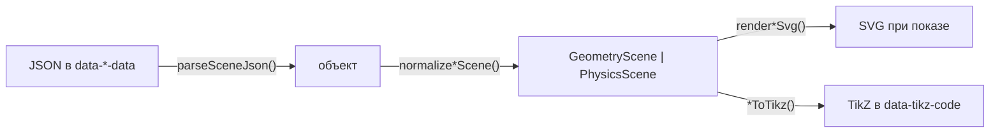

# 17. Чертежи: `@rich-editor/drawings`

## Назначение

Чертёж — блочный атомарный узел `geometry` или `physics`. Источник истины —
JSON-сцена в формате PinQueen в атрибуте `data-geometry-data` /
`data-physics-data` и TikZ в `data-tikz-code`; картинка рисуется по сцене при
показе и в HTML не хранится. Пакет даёт редактору два узла, две кнопки
тулбара и диалог с шаблонами, живым превью и TikZ, а вьюеру — лёгкий вход без
TipTap. Сцена хранится строкой как пришла: поля, которых рендер не знает, не
теряются.



## Когда использовать

- Геометрия: планиметрия (вершины, рёбра, углы, засечки, окружности),
  стереометрия (3D-вершины, сечения, цилиндры, кабинетная проекция), графики
  функций (парабола, корень, гипербола, прямая, окружность, штриховка, точки).
- Физика: механика, термодинамика, электрические цепи, оптика — элементы с
  типом и координатами.
- Документы от распознавания: сцены приходят «грязными», нормализация
  принимает синонимы и старые форматы; битый JSON показывается плейсхолдером.

## Интерфейс

Сигнатуры — [14-api-reference.md](14-api-reference.md#rich-editordrawings).

### Подключение

| Где | Что | Вход |
| --- | --- | --- |
| Редактор | `createRichEditor({ features: [createDrawingsFeature()] })`, `<RichEditor :features>` | `@rich-editor/drawings` |
| Вьюер | `createRichContent({ features: [drawingsContent] })` или `createDrawingsContent({ locale })` | `@rich-editor/drawings/viewer` |
| Стили | Подключаются сами при импорте из исходников; для `dist` — `@rich-editor/drawings/styles.css` | — |

`createDrawingsFeature({ toolbarItems?: boolean })`; подписи — `DRAWINGS_MESSAGES`
(ru, en), `messages` хоста их переопределяют. Заголовки карточек во вьюере
берутся из таблиц возможности по `locale` документной части.

### Формат узла

```html
<div data-geometry="true" data-geometry-data='{"type":"2d","vertices":{…},"edges":[…]}'
     data-tikz-code="\begin{tikzpicture}…" class="rte-drawing rte-drawing--geometry"
     role="img" aria-label="Чертёж"></div>
```

| Атрибут | Что хранит |
| --- | --- |
| `data-geometry-data`, `data-physics-data` | JSON-сцена строкой; узел читается и из `span`, и из `div` PinQueen |
| `data-tikz-code` | TikZ; генерируется диалогом из сцены, при импорте сохраняется |
| `aria-label` | Имя для читалки: «Чертёж» / «Физическая схема» |

Правила санитайзера — `DRAWINGS_SANITIZER_RULES` (пять атрибутов выше);
серверная копия — `DRAWINGS_ATTRS` в `rich_editor/sanitize.py`.

### Модель сцены

Геометрия (`GeometryScene`): `type` `2d | 3d | plot_2d` (3D с нулевой
глубиной понижается до 2D; без вершин, но с графиками — `plot_2d`),
`vertices` `{ A: [x, y] | [x, y, z] }`, `edges` (`from`, `to`, `style`
`solid | dashed`, `ticks` 0–4), `angles` (`points` — три вершины, вершина
угла вторая; `style` `right | single | double | triple`; `label`), `labels`
(положение буквы: `below left`, `above`…), `textLabels` (у середины отрезка
`position` со стороной `offset` или в точке `coords` мира), `sections` и
`cylinders` (только 3D), `plots`, `angleY`/`angleZ`, `scale`, `offsetX`/`offsetY`,
`showGrid`, `showAxes`, `axes`.

Графики (`Plot`): `circle` (`center` или `centerVertex`, `radius`, `fill`),
`parabola` (`vertex`, `direction`, `stretchX`, `stretchY`, `domain`), `sqrt`,
`hyperbola` (`center`, `k`), `line` (`p1`/`p2` или `k`/`b`), `point` (`coords`,
`pointStyle` `solid | hollow`, `label`), `shading` (`points` или `bounds`),
`freehand`.

Физика (`PhysicsScene`): `elements[]` с `id`, `type`, `label` (LaTeX-подмножество:
греческие буквы, индексы, `\vec{}`, `\text{}`), `color`, `dashed` и геометрией
`points` / `center` / `coords`. Типы по разделам:

| Раздел | Типы |
| --- | --- |
| Механика | `surface` (`hatching`), `arc_surface`, `block` (`subtype` rectangle/circle/pulley, `angle`), `rope`, `spring`, `vector` (`vectorType` force/acc), `angle`, `stickman`, `balloon`, `ellipse_platform`, `dimension_line` |
| Термодинамика | `thermo_axes` (`xTicks`/`yTicks`), `thermo_point`, `thermo_process` (`subtype` line/isotherm/isochor), `piston_vessel` |
| Электричество | `circuit_component` (resistor/capacitor/inductor/switch/source/battery/voltmeter/ammeter/lamp/diode), `wire` (`wavy`), `charge`, `field_line`, `capacitor_plate`, `current_conductor`, `circle_shape` |
| Оптика | `lens` (converging/diverging, `focalLength`), `mirror`, `ray`, `optics_arrow`, `prism`, `glass_slab` |
| Общее | `text_label` |

### Нормализация

`parseSceneJson(text)` — терпимый разбор: ограждение ```` ```json ````, LaTeX-слеши
в строках, хвостовые запятые, одинарные и «умные» кавычки, ключи без кавычек,
комментарии; без `eval`. `normalizeGeometryScene(raw)` и
`normalizePhysicsScene(raw)` принимают что угодно и всегда возвращают сцену:
рёбра массивом, `{from,to}`, `{start,end}`, `{source,target}`; `circle`/`circles`;
`markings` как углы (без точек — пропуск); синонимы элементов `wall → surface`,
`weight`/`box` → `block`, `piston` → `piston_vessel`, `point` → `charge`,
`axis` → `vector`; группы `vessels`/`charges`/`vectors`/`elements`; старые
термографики `graph`, `graph_pV` и верхнеуровневые `thermo_*` с нормировкой
координат в окно 2..6 × 1.5..5.5; `splitEdgesThroughVertices` режет рёбра,
на которых лежит вершина. Подмены сцены `incline` шаблоном, как в оригинале,
нет: данные пользователя не выбрасываются. `detectDrawingKind(raw, hint?)`
отличает физику от геометрии по типу, термо-полям и элементам.

### Рендер и экспорт

| Функция | Что делает |
| --- | --- |
| `renderGeometrySvg(scene, { width?, height?, highlight?, autoFit? })` | SVG 300×300; слои: сетка → сечения → цилиндры → рёбра → углы → окружности → вершины → подписи; `plot_2d` — оси, тики и графики |
| `renderPhysicsSvg(scene, { width?, height?, highlight?, autoFit? })` | SVG 340×300 со всеми типами элементов |
| `renderDrawingPreview(kind, scene, scale?)` | Превью карточки 340×300 с `autoFit`; `null`, если рисовать нечего |
| `geometryToTikz(scene)`, `physicsToTikz(scene)` | TikZ: 3D со `scale=3` и стилями hidden/visible, 2D с `\pic{angle}`, графики в `axis`; физика со `scale=0.5`, пружина `coil`, цепи в ключах circuitikz (`to[R]`, `to[C]`, `to[L]`, `battery1`…), изотерма гладкой кривой |
| `parsePgfplotsTikz(tikz)` | Сцена `plot_2d` из `\addplot`, если JSON нет |

Координаты: ось y вверх, масштаб 25 px на единицу (графики — 20); 3D —
поворот `angleZ`, затем `angleY`, затем кабинетная проекция (глубина под 45°
с коэффициентом 0.5). `autoFit` вписывает сцену в картинку: масштаб 12–120
для геометрии, 12–80 для физики. Линии и текст — `currentColor`, подложки
подписей и сетка — классы под тему; явные цвета элементов (силы синие,
ускорения красные, подсветка `#ec4899`) остаются.

## Пример

```ts
import { createRichEditor } from '@rich-editor/core';
import { createDrawingsFeature } from '@rich-editor/drawings';

createRichEditor({ element, features: [createDrawingsFeature()] });
```

```ts
import { createRichContent } from '@rich-editor/core/viewer';
import { createDrawingsContent } from '@rich-editor/drawings/viewer';

createRichContent({ element, html, features: [createDrawingsContent({ locale: 'ru' })] });
```

```ts
// Рендер вне редактора: сцена от бэкенда → SVG и TikZ.
import { normalizeGeometryScene, parseSceneJson, renderGeometrySvg, geometryToTikz } from '@rich-editor/drawings';

const scene = normalizeGeometryScene(parseSceneJson(text));
const svg = renderGeometrySvg(scene, { autoFit: true });
const tikz = geometryToTikz(scene);
```

## Ограничения

- Диалог редактирует сцену как JSON с превью; визуальные конструкторы
  (планиметрия, графики, физика, стереометрия) — следующие этапы.
- SVG в документе не хранится: вьюер без документной части вырежет узлы.
  Standalone-сборка и Django-виджет пакет пока не включают.
- `textLabels.coords` — координаты мира (в PinQueen это были пиксели).
- TikZ не компилируется в редакторе; это экспорт для бэкенда и LaTeX.

## См. также

- [16-chemistry.md](16-chemistry.md), [03-vanilla-ui.md](03-vanilla-ui.md#возможность-editorfeature),
  [06-viewer.md](06-viewer.md#возможности-во-вьюере-contentfeature),
  [11-security.md](11-security.md#правила-возможностей).
