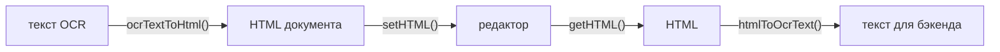

# 18. Текст распознавания: `@rich-editor/ocr`

## Назначение

Бэкенд распознаёт фото работы нейросетью и отдаёт текст в формате PinQueen:
Markdown и LaTeX с маркерами `<<<TIKZ_START>>>` / `<<<DATA_START>>>` для
чертежей и `\chemfig{…}` для структур. Пакет переводит этот текст в HTML
документа редактора и обратно — для показа, правки и повторной отправки на
бэкенд. Узлы формул, химии и чертежей получают те же контракты, что и в
редакторе, поэтому документ открывается с подключёнными возможностями
`@rich-editor/chemistry` и `@rich-editor/drawings`.



## Когда использовать

- После ответа `GET /ocr/status/{job_id}`: `ocrTextToHtml(raw_ocr_text, { subject, metadata })`
  → `editor.setHTML(html)`.
- Перед автосохранением и отправкой: `htmlToOcrText(editor.getHTML())`.
- Для документов, экспортированных самим PinQueen (`<p>`, `<span data-math-latex>`),
  — та же функция: HTML распознаётся и переводится в наш контракт.

## Интерфейс

Сигнатуры — [14-api-reference.md](14-api-reference.md#rich-editorocr).

| Функция | Возвращает | Что делает |
| --- | --- | --- |
| `ocrTextToHtml(text, { subject?, metadata?, wrapBareLatex? })` | `Promise<string>` | Текст → HTML документа; асинхронно, потому что LaTeX → MathML |
| `htmlToOcrText(html, { physicsSvg? })` | `Promise<string>` | HTML документа → текст с маркерами; формулы берут LaTeX из аннотации MathML, чужой MathML конвертируется |
| `ceToLatex(reaction)` | `string` | `2H2 + O2 -> 2H2O` → `2 \text{H}_2 + \text{O}_2 \to …` |
| `markdownToHtml`, `normalizeLatexText`, `wrapBareLatex`, `pipesToVmatrix`… | — | Шаги конвейера, доступны отдельно |

### Что понимает `ocrTextToHtml`

| Во входе | В документе |
| --- | --- |
| `# Заголовок`, `**жирный**`, `*курсив*`, `~~зачёркнуто~~`, `---` | `<h1>`…`<h3>`, `<strong>`, `<em>`, `<s>`, `<hr>` |
| Списки `* - •` и `1.` | `<ul>`, `<ol start>` — нумерация сохраняется |
| Таблицы `\| a \| b \|` с разделителем или соседними строками | `<table>` с заголовком |
| `$…$`, голые `\frac{…}`, окружения `\begin{cases}` | Формула MathML с аннотацией LaTeX (`data-formula-type="math"`) |
| `$$…$$` | Выключная формула: отдельный абзац по центру; реакции, `\text`, числа — строчные |
| `\ce{…}` в формуле или голый | Формула-реакция (`data-formula-type="chem"`), запись `\ce` переведена в LaTeX |
| `\chemfig{…}` | Узел структуры `data-chemistry-code` |
| Пара `TIKZ` + `DATA` (обёртки `<<<X>>>`, `[[[X]]]`, `$X$`) | Узел `geometry` или `physics` с `data-tikz-code`; вид — по типу сцены, термо-полям и элементам, затем по `subject` |
| `DATA` с `type: "chemistry"` или `chemistry_code` | Узел структуры (код — из блока `TIKZ`) |
| `$GEOMETRY_n$` и чертежи в `metadata` (`ocr_and_tikz_data`, `ocr_and_tikz_data_plots`) | Чертёж встаёт на место плейсхолдера или в конец |
| `<<<SVG_START>>>…`, `OCR_START`/`OCR_END` | Удаляются |
| HTML PinQueen: `<span data-math-latex>`, `span.geometry-node`, `<pre>{json}</pre>` | Наши узлы |

Текст экранируется: разметка из распознавания не исполняется. Формула,
которую MathLive не смог конвертировать, остаётся текстом `$…$`. Пустая
сцена без TikZ узла не даёт.

### Что пишет `htmlToOcrText`

Заголовки `#`, абзацы, `**`/`*`/`~~`, списки с нумерацией и вложенностью,
таблицы с разделителем заголовка, `---`, формулы `$…$`, абзац из одной формулы
— `$$…$$`, `\chemfig{код}`, геометрия — блоки `TIKZ` и `DATA`, физика — блок
`SVG` (340×300, для нейросети-проверяющего; `physicsSvg: false` отключает),
свой `TIKZ`, если есть, и `DATA`. Потери оригинала закрыты: нумерация,
зачёркивание, TikZ физики, тип химии.

## Пример

```ts
import { createRichEditor } from '@rich-editor/core';
import { createChemistryFeature } from '@rich-editor/chemistry';
import { createDrawingsFeature } from '@rich-editor/drawings';
import { htmlToOcrText, ocrTextToHtml } from '@rich-editor/ocr';

const editor = createRichEditor({ element, features: [createChemistryFeature(), createDrawingsFeature()] });

// Ответ бэкенда → документ.
const status = await fetch(`/ocr/status/${jobId}`).then((r) => r.json());
editor.core.setHTML(await ocrTextToHtml(status.raw_ocr_text, { subject: 'physics', metadata: status.metadata }));

// Документ → текст для автосохранения.
const essayText = await htmlToOcrText(editor.core.getHTML());
```

## Ограничения

- Выключность формулы хранится не атрибутом, а абзацем из одной формулы:
  формула, добавленная в такой абзац рядом с текстом, станет строчной.
- Markdown — подмножество бэкенда: без ссылок, картинок и вложенных списков
  во входе (вложенность сохраняется только при сериализации).
- Оборачивание голого LaTeX — эвристика; для текста, где оно мешает,
  `wrapBareLatex: false`.
- Нет функции показа сырого текста с KaTeX (в PinQueen —
  `normalizeOcrTextForDisplay`): документ показывает вьюер.

## См. также

- [16-chemistry.md](16-chemistry.md), [17-drawings.md](17-drawings.md),
  [04-formulas.md](04-formulas.md).
