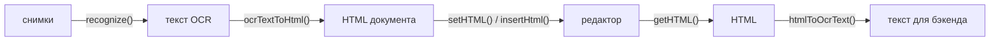

# 18. Текст распознавания: `@rich-editor/ocr`

## Назначение

Бэкенд распознаёт фото работы нейросетью и отдаёт текст в формате PinQueen:
Markdown и LaTeX с маркерами `<<<TIKZ_START>>>` / `<<<DATA_START>>>` для
чертежей и `\chemfig{…}` для структур. Пакет переводит этот текст в HTML
документа редактора и обратно — для показа, правки и повторной отправки на
бэкенд — и даёт кнопку «Распознать фото»: снимки уходят адаптеру хоста, ответ
встаёт в документ. Узлы формул, химии и чертежей получают те же контракты,
что и в редакторе, поэтому документ открывается с подключёнными возможностями
`@rich-editor/chemistry` и `@rich-editor/drawings`.



## Когда использовать

- Снимки выбирает пользователь в редакторе: `createOcrFeature({ recognize })` —
  кнопка тулбара, проверки файлов, строка статуса и вставка результата; хост
  пишет только адаптер к своему API (см. «Распознавание из редактора»).
- Снимки уже распознаны (например, после ответа `GET /ocr/status/{job_id}`):
  `ocrTextToHtml(raw_ocr_text, { subject, metadata })` → `editor.setHTML(html)`.
- Перед автосохранением и отправкой: `htmlToOcrText(editor.getHTML())`.
- Для документов, экспортированных самим PinQueen (`<p>`, `<span data-math-latex>`),
  — та же функция: HTML распознаётся и переводится в наш контракт.

## Распознавание из редактора

Возможность устроена как загрузка картинок: редактор берёт файлы у
пользователя и проверяет их, хост отвечает за сеть. Адаптер получает снимки и
возвращает ответ бэкенда; что внутри — один запрос или задача с опросом
статуса, — редактору не важно.

```ts
import { createRichEditor } from '@rich-editor/core';
import { createChemistryFeature } from '@rich-editor/chemistry';
import { createDrawingsFeature } from '@rich-editor/drawings';
import { createOcrFeature, type RecognizeAdapter } from '@rich-editor/ocr';

const recognize: RecognizeAdapter = async (files, { signal, subject }) => {
  const body = new FormData();
  files.forEach((file) => body.append('images', file));
  const { job_id } = await fetch('/ocr/scan', { method: 'POST', body, signal }).then((r) => r.json());

  let status;
  do {
    await new Promise((resolve) => setTimeout(resolve, 5000));
    status = await fetch(`/ocr/status/${job_id}`, { signal }).then((r) => r.json());
  } while (status.state !== 'completed');

  return { text: status.raw_ocr_text, metadata: status.metadata, subject, scans: status.image_urls };
};

const ocr = createOcrFeature({ recognize, subject: () => currentSubject });
const editor = createRichEditor({
  element,
  features: [createChemistryFeature(), createDrawingsFeature({ scans: ocr.scans }), ocr],
  onError: (error) => error.code === 'recognize-failed' && notify(error.message),
});
```

| Опция | По умолчанию | Что делает |
| --- | --- | --- |
| `recognize` | — | Адаптер: `(files, { signal, t, subject }) => Promise<{ text, subject?, metadata?, scans? }>` |
| `subject` | — | Предмет для разбора текста: значение или функция; `subject` из ответа главнее |
| `maxFiles` | `3` | Больше снимков за раз — ошибка `recognize-failed` до вызова адаптера |
| `replace` | `false` | Вставлять вместо документа, а не в позицию курсора |
| `wrapBareLatex` | — | Как у `ocrTextToHtml` |
| `toolbarItem` | `true` | `false` — без кнопки; снимки отдаёт сам хост через `ocr.recognize(files)` |

Снимки проходят те же проверки, что у загрузки картинок: только `image/*`,
не больше `limits.maxImageSizeBytes`. Пока бэкенд отвечает, строка статуса
показывает «Распознаём фото…», повторный запуск не принимается. Исключение
адаптера или пустой ответ отменяют вставку и приходят в `onError` с кодом
`recognize-failed`; прерванное уничтожением редактора распознавание ничего не
вставляет. `ocr.scans()` отдаёт адреса снимков последнего распознавания — из
ответа адаптера (`scans`) или локальные `blob:` — для панели сканов рядом с
конструктором чертежей.

## Интерфейс

Сигнатуры — [14-api-reference.md](14-api-reference.md#rich-editorocr).

| Функция | Возвращает | Что делает |
| --- | --- | --- |
| `ocrTextToHtml(text, { subject?, metadata?, wrapBareLatex? })` | `Promise<string>` | Текст → HTML документа; асинхронно, потому что LaTeX → MathML |
| `htmlToOcrText(html, { physicsSvg? })` | `Promise<string>` | HTML документа → текст с маркерами; формулы берут LaTeX из аннотации MathML, чужой MathML конвертируется |
| `ceToLatex(reaction)` | `string` | `2H2 + O2 -> 2H2O` → `2 \text{H}_2 + \text{O}_2 \to …` |
| `createOcrFeature({ recognize, … })` | `OcrFeature` | Возможность «Распознать фото»; `scans()`, `recognize(files)` |
| `markdownToHtml`, `normalizeLatexText`, `wrapBareLatex`, `pipesToVmatrix`… | — | Шаги конвейера, доступны отдельно |

### Что понимает `ocrTextToHtml`

| Во входе | В документе |
| --- | --- |
| `# Заголовок`, `**жирный**`, `*курсив*`, `~~зачёркнуто~~`, `---` | `<h1>`…`<h3>`, `<strong>`, `<em>`, `<s>`, `<hr>` |
| Списки `* - •` и `1.` | `<ul>`, `<ol start>` — нумерация сохраняется |
| Таблицы `\| a \| b \|` с разделителем или соседними строками | `<table>` с заголовком |
| `$…$`, голые `\frac{…}`, окружения `\begin{cases}` | Формула MathML с аннотацией LaTeX (`data-formula-type="math"`) |
| `$$…$$` | Выключная формула: отдельный абзац по центру; реакции, `\text`, числа — строчные |
| `\ce{…}` в формуле или голый | Формула-реакция (`data-formula-type="chem"`), запись `\ce` переведена в LaTeX |
| `\chemfig{…}` | Узел структуры `data-chemistry-code` |
| Пара `TIKZ` + `DATA` (обёртки `<<<X>>>`, `[[[X]]]`, `$X$`) | Узел `geometry` или `physics` с `data-tikz-code`; вид — по типу сцены, термо-полям и элементам, затем по `subject` |
| `DATA` с `type: "chemistry"` или `chemistry_code` | Узел структуры (код — из блока `TIKZ`) |
| `$GEOMETRY_n$` и чертежи в `metadata` (`ocr_and_tikz_data`, `ocr_and_tikz_data_plots`) | Чертёж встаёт на место плейсхолдера или в конец |
| `<<<SVG_START>>>…`, `OCR_START`/`OCR_END` | Удаляются |
| HTML PinQueen: `<span data-math-latex>`, `span.geometry-node`, `<pre>{json}</pre>` | Наши узлы |

Текст экранируется: разметка из распознавания не исполняется. Формула,
которую MathLive не смог конвертировать, остаётся текстом `$…$`. Пустая
сцена без TikZ узла не даёт. Пустые строки разделяют блоки, но пустыми
абзацами не становятся.

Блоки `DATA`, `TIKZ` и HTML-узлы снимаются до правок LaTeX и Markdown, поэтому
`\\frac` в JSON сцены и `\\` в TikZ доходят до узла нетронутыми. Сцена ложится
в узел строгим JSON: терпимый разбор чинит хвостовые запятые, кавычки и LaTeX
без второго слеша, неизвестные поля сохраняет. Текст, который не разобрать,
остаётся как есть, и узел показывает ошибку.

### Что пишет `htmlToOcrText`

Заголовки `#`, абзацы, `**`/`*`/`~~`, списки с нумерацией и вложенностью,
таблицы с разделителем заголовка, `---`, формулы `$…$`, абзац из одной формулы
— `$$…$$`, `\chemfig{код}`, геометрия — блок `DATA` и `TIKZ`, если он есть, физика — блок
`SVG` (340×300, для нейросети-проверяющего; `physicsSvg: false` отключает),
свой `TIKZ`, если есть, и `DATA`. Потери оригинала закрыты: нумерация,
зачёркивание, TikZ физики, тип химии.

## Пример

```ts
import { createRichEditor } from '@rich-editor/core';
import { createChemistryFeature } from '@rich-editor/chemistry';
import { createDrawingsFeature } from '@rich-editor/drawings';
import { htmlToOcrText, ocrTextToHtml } from '@rich-editor/ocr';

const editor = createRichEditor({ element, features: [createChemistryFeature(), createDrawingsFeature()] });

// Ответ бэкенда → документ.
const status = await fetch(`/ocr/status/${jobId}`).then((r) => r.json());
editor.core.setHTML(await ocrTextToHtml(status.raw_ocr_text, { subject: 'physics', metadata: status.metadata }));

// Документ → текст для автосохранения.
const essayText = await htmlToOcrText(editor.core.getHTML());
```

## Ограничения

- Выключность формулы хранится не атрибутом, а абзацем из одной формулы:
  формула, добавленная в такой абзац рядом с текстом, станет строчной.
- Markdown — подмножество бэкенда: без ссылок, картинок и вложенных списков
  во входе (вложенность сохраняется только при сериализации).
- Оборачивание голого LaTeX — эвристика; для текста, где оно мешает,
  `wrapBareLatex: false`.
- Нет функции показа сырого текста с KaTeX (в PinQueen —
  `normalizeOcrTextForDisplay`): документ показывает вьюер.

## См. также

- [16-chemistry.md](16-chemistry.md), [17-drawings.md](17-drawings.md),
  [04-formulas.md](04-formulas.md).
